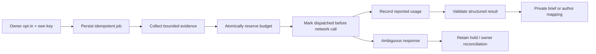

Current model IDs, rates and defaults: [model catalog](MODELS.md). Owner controls: [admin operations](ADMIN.md). Market data: [macro sources](MACRO.md). Strategy methods: [comparisons](STRATEGIES.md).

# Intelligence: operation and boundaries

## Operator configuration

The existing Docker volume remains authoritative for all accounts and data. The new tables are additive. The portfolio core keeps `PRAGMA user_version=1`; `module_migrations` independently versions intelligence. `module_compatibility.minimum_schema` declares the oldest compatible application schema: additive future steps may keep this floor, but breaking steps must raise it and require a maintenance/rollback plan. Unknown future versions without an explicit compatible floor fail closed. A portfolio-only rollback image can ignore the added tables without rejecting the database.

Set these values in the server’s private `.env` (mode 0600), then recreate the app with the existing Compose project and volume:

```dotenv
# Generate once with: openssl rand -base64 32
AI_MASTER_KEY=<32 random bytes, base64 encoded>
ENABLE_BACKGROUND_JOBS=true
AUTHOR_USERNAMES=<exact existing Reentry username>
AUTHOR_PUBLIC_NAME=RNT
SEC_USER_AGENT=Reentry research operator-contact@example.com
```

No account gains author access automatically. Keep `.env` out of Git. Back up the master key **separately and securely** from SQLite; encrypted user API keys cannot be recovered without it. Do not replace this key during routine deployment. A missing master key disables credential storage; a malformed key prevents startup. A wrong but well-formed key cannot decrypt existing credentials and requires restoring the correct key or reconnecting users’ provider credentials. TLS terminates at the existing Caddy; the application port remains bound to loopback. No email server is needed.

On the configured VPS, the installed Compose file and deployment runner live outside the Git checkout. Update their reviewed copies when their contracts change; a normal Git push updates only the app image. A 60-second shutdown grace allows source retrieval to finish and interrupted provider calls to be recorded. Run one application/worker instance against this SQLite database. Multi-host workers require a dedicated queue and fenced leases; they are not supported by this release.

## Ownership

| Data | Access and payment |
| --- | --- |
| Portfolio, buy-ins, trade records | Existing private account APIs; never included automatically in research prompts |
| Provider keys, preferences, budgets, ledger | Only their authenticated owner; every job uses that owner’s key |
| Sources, notes, briefs, private scenarios | Only their owner; notes are included in that asset’s subsequent research |
| Author draft and AI mappings | Author-only endpoints; private until explicit review and publish |
| Published article edition and its scenario evidence | Explicit public DTO and server-rendered `/journal` pages; no account IDs, private prompts, keys or ledger |
| Reader’s copy of a public scenario | Independent private set with published-edition provenance; revisions create a new private set |

Publication snapshots the article, source references, author name and mapped branches in one transaction. Editing a draft leaves published editions unchanged. Publishing requires the latest draft revision and an explicit reviewed flag. Stale saves fail with 409. Every public branch must point to an exact passage in the article. AI output can never publish or verify an event. Unpublishing hides all editions from public routes while preserving the internal record and any independently created private copies.

The author allowlist grants publishing rights, not access to other users’ accounts. There is no global administrator UI for reading users’ private research or API keys.

## Data connectors

Portfolio holdings are resolved across every depot and deduplicated by symbol, excluding demo holdings. They appear in the owner's Research list without creating a manual research preference or enabling scheduled AI. `server/intelligence/portfolio-sources.js` independently collects their public evidence when `ENABLE_BACKGROUND_JOBS=true`, including for accounts without a provider key and while paid AI is paused. Existing portfolios are scanned on worker startup; portfolio saves queue new holdings. Symbols and asset names go to the existing public connectors; quantities and buy-in prices do not.

Collection state is persisted in the additive `source_refresh_states` table. Successful collections refresh after six hours; partial collections retry after thirty minutes; failures back off from five minutes to six hours. The worker processes two assets per tick with fair scheduling across owners. At most four unique upstream collections run together, with a bounded waiting queue and in-flight deduplication. Existing stored evidence survives connector failures. Removing a holding stops its automatic refresh while retaining its evidence and any independently saved research preference. Startup with background jobs disabled creates the additive table without changing existing durable rows, preserving deployment canary checks.

Private source APIs include collection status and provider coverage. The Sources panel refreshes active collections without rebuilding the chart or closing an article the user is reading. No source refresh creates an AI job, reserves a budget, or invokes Gemini/Claude. Paid research remains an explicit action or an existing opted-in schedule.

| Connector | Data | Coverage/limits |
| --- | --- | --- |
| Yahoo Finance | Exact listing search, quotes, FX, history, related-ticker headlines | Unofficial endpoints; may change, throttle or be delayed. Headline metadata is explicitly distinguished from full article text. Existing adapter is replaceable. |
| SEC EDGAR | Exact US ticker-to-CIK mapping, recent filing metadata and selected US-GAAP XBRL facts | Real operator contact required. Requests share a bounded queue with at least 160 ms between starts. Foreign/non-SEC instruments may have no match. Facts retain units, form, start/end and filing dates; they are not presented as comparable TTM figures. |
| GDELT | Company-name-matched news discovery | Availability and entity coverage vary. Name matching can miss aliases; evidence requires review. An outage is shown as partial coverage. |
| Manual source text | Private notes/excerpts with optional HTTPS source reference | No arbitrary URL fetch or hidden crawl. Up to 200 notes/account, 15,000 characters each; only the latest three notes for an asset enter a research run. |
| RNT articles | Author text mapped into explicit conditional branches | Mapping uses a frozen draft revision; the UI rejects applying a stale mapping over an edited draft. |

Outbound connector hosts are fixed in code. Redirects are rejected, responses and request durations bounded, in-flight work deduplicated, and cache size limited. Partial failures do not invent facts or erase a portfolio. The model is never allowed to choose fetch destinations, call tools, run code, trade, or obtain credentials. Provider adapters receive only the assembled research prompt. Private portfolio quantities and cost basis are outside this boundary.

Job snapshots preserve the exact selected evidence, provenance, collection times, model, prompt version and source IDs. Inputs are bounded: up to 18 sources, excerpts for long text, and the first 18,000 characters of long articles. Fundamentals and filings take priority over extra headlines. Truncation is carried into the brief’s limitations. Source-ID validation proves provenance, not factual correctness; the UI labels AI claims and interpretations accordingly. Sentiment describes the supplied sample, not overall market sentiment or a calibrated trading score. News, filings, event feeds and fundamentals are not guaranteed to cover every asset or event.

## AI provider contract

`createProviders()` supports an explicit priced allowlist of Gemini and Claude models using their direct APIs. Provider keys are encrypted with AES-256-GCM, random nonces, and authenticated data bound to the owning user and provider. Read endpoints return only a fingerprint and update time. Keys and prompts are not logged. Restoring the database and master key restores access; rotating a provider key does not delete its historical usage ledger.

Requests use fixed HTTPS destinations, no redirects, an 8,192-token output ceiling, a bounded prompt and a 90-second provider deadline. No billable search tools, batch mode, paid cache creation or provider-selected arbitrary model names are requested. Structured JSON is checked again locally for sizes, types, ranges, dates, exact article passages and valid source references. Unknown model routing or unrecognized token/tool accounting retains a reservation for manual reconciliation instead of assigning a misleading zero cost.

Current API contracts/prices were checked on 2026-11-14:

- [Gemini pricing](https://aistudio.google.com/docs/pricing), [generateContent reference](https://aistudio.google.com/api-reference/generate-content).
- [Claude pricing](https://platform.claude.com/docs/en/about-claude/pricing), [structured outputs](https://platform.claude.com/docs/en/build-with-claude/structured-outputs), [Messages API](https://platform.claude.com/docs/en/api/messages/create), API version `2026-10-21`.
- [SEC APIs](https://www.sec.gov/search-filings/edgar-application-programming-interfaces), [GDELT DOC API](https://blog.gdeltproject.org/gdelt-doc-2-0-api-debuts/).

The catalog encodes the announced 2027-01-01 Gemini Flash price change and Claude Haiku’s input-size tier. It refuses new requests after 2027-02-12 until an operator reviews and updates the catalog. Add a model through `server/ai/catalog.js`, its provider contract tests, and a reviewed price source; never accept an arbitrary client-supplied model with guessed pricing. BYOC credentials may need paid-tier access or provider-specific model permissions. Google’s free-tier data-use policy is disclosed before enabling AI.

## Cost ledger and job lifecycle

All amounts use integer USD microdollars. Each paid request receives a transactional reservation based on a conservative UTF-8 input bound, schema overhead and the output ceiling. Reservations count against both the per-run and UTC-calendar-month account limits. Outstanding/unconfirmed holds carry across month boundaries. Default limits are $5/month and $0.25/run. Users may change their own caps; outside-provider usage cannot be limited by Reentry.



Input, cached input, cache writes, output/reasoning tokens, reported usage, provider request ID, actual response model, price snapshot and estimated amount are retained. Valid usage is charged to the ledger even if output is refused, truncated or fails validation. A confirmed pre-generation rejection releases the reservation. A timeout, lost connection, invalid usage response or interrupted post-dispatch worker keeps an unconfirmed hold. **No automatic retry occurs after dispatch.** An expired pre-dispatch lease fails safely without a model call. Job cancellation only cancels queued work; deleting a key or disabling AI cancels queued calls, not already dispatched work.

Ledger amounts are **list-price estimates**, not provider invoices. Free credits, account discounts, taxes, prepaid balances and calls made outside Reentry are not observable using ordinary BYOC keys. Reconciliation requires the owner to check the provider receipt, enter the confirmed amount and record an audit note. Underestimated reservations disable further AI for that account; the actual reported usage still appears. The settings ledger shows 500 recent entries; full research export includes every stored ledger row. Use provider-side spending controls as the external billing boundary.

One bounded worker claims persisted jobs. Each account has at most two queued/running jobs, forty new jobs per 24 hours, fifty research assets and five hundred scenario sets. Scheduling is opt-in per asset (6–168 hours). A full queue postpones a scheduled attempt instead of skipping the whole interval. Paid runs stop when the account budget or configured provider fails; the latest job records the reason. Disabling the worker leaves jobs durable. Deployment canaries explicitly disable it and have no network access.

## Scenario evidence

Scenario sets preserve the thesis date, condition, target range, currency, horizon, invalidation and provenance. Private revisions are independent; published branches are edited only by publishing another article edition. Quotes are sampled about every fifteen minutes, converted from quote subunits once, and compared only in the matching listing currency. Old qualifying price hits are fetched independently of the recent-display window so they cannot disappear when new samples arrive.

A branch requires a human-verified condition before its price range counts as observed. AI can suggest source-linked condition matches for review; a headline never automatically becomes a verified event. Verification requires a source URL, event time and explicit confirmation. Occurrence and knowledge time are separate. Retractions preserve an audit trail and historical knowledge evaluation. A later invalidation cannot erase an already observed outcome, and events after the thesis deadline do not rewrite it. Quotes are samples, not a complete intraday tape: gaps, stale quotes, splits and missed touches require interpretation. The current UI shows present state plus evidence and immutable editions; a full interactive historical replay and corporate-action adjustment system remain separate future work.

## Validation and backup

Run `npm run check`, `npm test`, `npm run build`, and `python3 -m unittest discover -s tests -p 'test_*.py'`. Fake-provider integration tests exercise ownership, ciphertext binding, reservation races, ambiguous failures, lease recovery, idempotency, scheduled runs, provider errors, publication, escaping and scenario chronology. Local browser QA uses a disposable database and simulated model calls. Paid live-model verification requires a user-entered key; never substitute a shared operator key or fabricate a successful provider response.

Automatic deployment backs up SQLite, preflights the candidate on an isolated copy, and compares **all existing durable table fields** (including keys, costs and articles). New empty tables/columns are allowed; destructive mutation needs separate migration review. Failure restores the prior image without restoring an old database over current writes. Preserve the master key, take encrypted off-server backups, and periodically test restoration to an isolated environment. SQLite backups alone do not preserve the separate master key. Public article snapshots and private research exports omit provider secrets.
